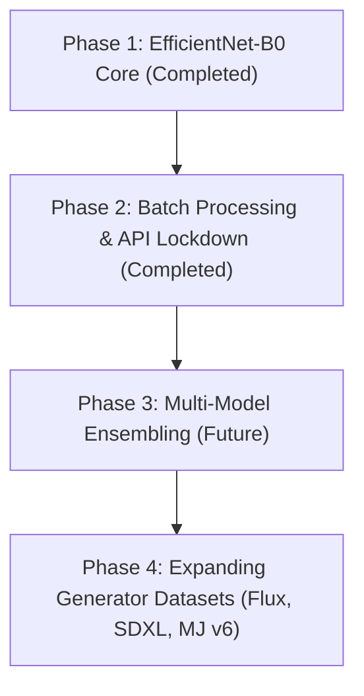

# 🔭 Product Vision & Architectural Goals

> [!INFO] Related Documents
> * Back to [[Index|Vault Home]]
> * [[PRD]]
> * [[Design System & Theme]]
> * [[System Architecture]]

---

## 🌟 Product Vision

The **AI Image Detector** (Neural Forensic Engine) aims to be a state-of-the-art, privacy-preserving visual forensic scanner. It combines high-accuracy deep learning classification with an immersive, cyberpunk tactical user interface.

---

## 🎯 Core Architectural Goals

### 1. 🔒 Local-First & Zero Data Retention
* All processing happens locally or on dedicated backend servers under user control.
* Uploaded image bytes are processed strictly in RAM (`io.BytesIO`) during forward pass execution and discarded immediately after.
* No user tracking, no third-party telemetry, and no image binary disk storage.

### 2. ⚡ Ultra-Low Latency Inference
* Model execution latency target is **< 15 ms on CPU** and **< 5 ms on GPU**.
* Achieved via singleton model pre-loading (`initialize_model()`), PyTorch `torch.no_grad()`, and GPU Mixed Precision (AMP).

### 3. 🎨 Immersive Cyberpunk User Experience
* High-contrast dark void aesthetic (`#0b0c10`) with glowing cyan highlights (`#66fcf1`).
* Monospace terminal log simulators and 3D particle backdrops bring deep tech aesthetics to forensic media analysis.
* See [[Design System & Theme]] for exact visual specifications.

### 4. 🛡️ Robust Security First
* Protection against content-type sniffing and malicious file uploads using magic byte verification (`validate_image_magic_bytes`).
* Strict CORS lockdowns and request size limits enforced directly at the HTTP middleware layer.
* See [[Security Guidelines]] for full details.

---

## 🧭 Strategic Roadmap & Future Considerations

* **Phase 1:** Train & evaluate EfficientNet-B0 classifier, build React SPA. (Done)
* **Phase 2:** Build batch endpoint (`/predict/batch`), rate limiting, security headers. (Done)
* **Phase 3:** Explore multi-model ensemble (EfficientNet-B0 + ViT / ResNet). (Future)
* **Phase 4:** Expand dataset pipeline for newer diffusion models (Flux, Midjourney v6). (Future)
