# 📊 Success Metrics & Benchmark Results

> [!INFO] Related Documents
> * Back to [[Index|Vault Home]]
> * [[PRD]]
> * [[Model Overview]]
> * [[Model Comparison]]
> * [[EfficientNet-B0]]
> * [[ForensicNet]]
> * [[Evaluation & Benchmark Results]]

---

## 📈 Official Dual-Model Evaluation Summary

All metrics are sourced directly from `backend/ml/evaluation_results.json` and `backend/ml/evaluation_results_forensicnet.json`, evaluated on the identical held-out test split (15% of the 48,000 image Kaggle dataset).

> [!SUCCESS] Model Performance Highlights
> * **EfficientNet-B0 Accuracy:** **97.82%** (`0.9782`) | **AUC-ROC:** **0.9979** | **GPU Latency:** **3.78 ms** | **Parameters:** **4.66M**
> * **ForensicNet Accuracy:** **94.83%** (`0.9483`) | **AUC-ROC:** **0.9903** | **GPU Latency:** **1.78 ms** | **Parameters:** **1.05M**

---

## 📋 Comprehensive Side-by-Side Metric Table

| Metric Category | Metric Name | EfficientNet-B0 | ForensicNet | Standard Target | Status |
| :--- | :--- | :--- | :--- | :--- | :--- |
| **Classification** | Overall Test Accuracy | **97.82%** | **94.83%** | > 90.00% | ✅ PASS |
| **Classification** | AUC-ROC Score | **0.9979** | **0.9903** | > 0.9500 | ✅ PASS |
| **Classification** | Macro Precision | **97.82%** | **94.83%** | > 90.00% | ✅ PASS |
| **Classification** | Macro Recall | **97.82%** | **94.84%** | > 90.00% | ✅ PASS |
| **Classification** | Macro F1-Score | **97.82%** | **94.83%** | > 90.00% | ✅ PASS |
| **Latency** | GPU Forward Pass | **3.78 ms** | **1.78 ms** (Winner) | < 10.00 ms | ✅ PASS |
| **Latency** | CPU Forward Pass | **12.24 ms** (Winner) | **85.76 ms** (FFT shift) | < 100.00 ms | ✅ PASS |
| **Model Size** | Total Parameters | **4.66M** (4,664,446) | **1.05M** (1,048,942) | < 10.00M | ✅ PASS |
| **Training Time** | Epochs / Duration | 40 Epochs (540.7 min) | 40 Epochs (535.8 min) | N/A | Completed |

---

## 🎯 Per-Class Performance Breakdown

### EfficientNet-B0
| Class Label | Precision | Recall | F1-Score | Test Samples |
| :--- | :--- | :--- | :--- | :--- |
| **AI Generated (Class 0)** | 97.79% | 97.82% | 97.81% | 3,600 |
| **Real Photograph (Class 1)** | 97.84% | 97.82% | 97.83% | 3,600 |

### ForensicNet
| Class Label | Precision | Recall | F1-Score | Test Samples |
| :--- | :--- | :--- | :--- | :--- |
| **AI Generated (Class 0)** | 94.43% | 95.23% | 94.83% | 3,600 |
| **Real Photograph (Class 1)** | 95.24% | 94.44% | 94.84% | 3,600 |

---

## ⚡ Latency & Hardware Benchmarks

```mermaid
gantt
    title Single Image Inference Latency Comparison (GPU vs CPU)
    dateFormat  X
    axisFormat %s ms
    section GPU (NVIDIA CUDA)
    ForensicNet (1.78 ms)        : active, 0, 2
    EfficientNet-B0 (3.78 ms)    : active, 0, 4
    section CPU (Host Processor)
    EfficientNet-B0 (12.24 ms)   : done, 0, 12
    ForensicNet (85.76 ms)       : crit, 0, 86
```

> [!TIP] Latency Analysis Key Finding
> * **GPU Deployment:** ForensicNet delivers the fastest GPU forward pass at **1.78 ms** (a 2.1x speedup over EfficientNet-B0) with a **4.4x smaller parameter footprint** (1.05M vs 4.66M).
> * **CPU Deployment:** EfficientNet-B0 is significantly faster on host CPU at **12.24 ms** vs ForensicNet's **85.76 ms**. ForensicNet's CPU latency is bottlenecked by 2D Discrete Fast Fourier Transform (`torch.fft.fft2`) and 2D magnitude spectrum shift operations performed sequentially on host CPU cores.

---

## 🔗 Next Steps
* Detailed model architectural comparison is documented in [[Model Comparison]].
* Model implementations: [[EfficientNet-B0]] and [[ForensicNet]].
* Diagnostic plots and script outputs: [[Evaluation & Benchmark Results]].
