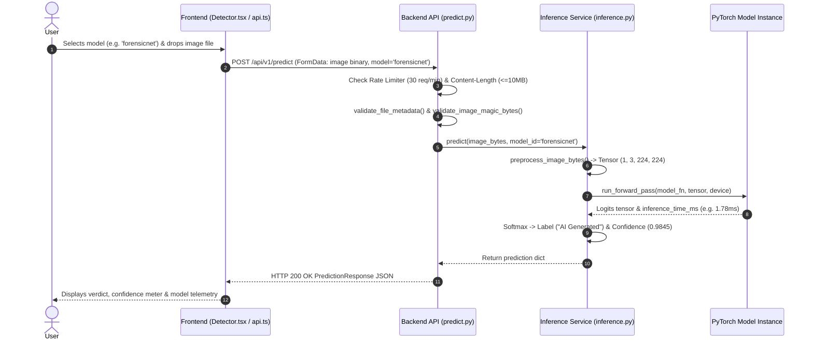

# 📡 REST API Specification

> [!INFO] Related Documents
> * Back to [[Index|Vault Home]]
> * [[Backend Architecture]]
> * [[Model Overview]]
> * [[Security Guidelines]]
> * [[Inference Service]]

---

## 🟢 1. Health Check Endpoint

### `GET /health`
Returns operational health of the backend web server and PyTorch model state.

* **Auth Required:** No
* **Rate Limit:** Unrestricted

#### Response Schema (`200 OK`)
```json
{
  "status": "operational",
  "model_loaded": true,
  "device": "cuda"
}
```

---

## 🟣 2. Available Models Endpoint

### `GET /api/v1/models`
Returns metadata, test set metrics, parameter counts, and availability for all registered models dynamically.

* **Auth Required:** No
* **Rate Limit:** Unrestricted

#### Response Schema (`200 OK`)
```json
[
  {
    "id": "efficientnet",
    "display_name": "EfficientNet-B0",
    "description": "Transfer-learned CNN, highest accuracy",
    "test_accuracy": 0.9782,
    "auc_roc": 0.9979,
    "params": "4.66M",
    "avg_inference_ms_gpu": 3.78,
    "available": true
  },
  {
    "id": "forensicnet",
    "display_name": "ForensicNet",
    "description": "Custom tri-stream forensic architecture (noise + frequency + spatial analysis), faster GPU inference",
    "test_accuracy": 0.9483,
    "auc_roc": 0.9903,
    "params": "1.05M",
    "avg_inference_ms_gpu": 1.78,
    "available": true
  }
]
```

---

## 🟡 3. Single Image Prediction Endpoint

### `POST /api/v1/predict`
Classifies a single uploaded image using the specified model (`"efficientnet"` or `"forensicnet"`).

* **Content-Type:** `multipart/form-data`
* **Form Parameters:**
  - `image` (UploadFile, required): Raw image binary file.
  - `model` (string, optional): Model selector (`"efficientnet"` [default] or `"forensicnet"`). Can also be passed as query param `?model=forensicnet`.
* **Max Payload Size:** **10 MB**
* **Rate Limit:** **30 requests / minute** per client IP

#### Single Prediction Request Flow Sequence


* 🖼️ Static Image Fallback: [[../assets/diagrams/04-single-image-prediction-sequence.png|Static PNG version (04-single-image-prediction-sequence.png)]]

#### Success Response (`200 OK`)
```json
{
  "label": "AI Generated",
  "confidence": 0.9845,
  "inference_time_ms": 1.78,
  "model_used": "forensicnet",
  "model_display_name": "ForensicNet"
}
```

#### Possible Error Responses

| Status Code | Error Detail Message | Cause |
| :--- | :--- | :--- |
| `400 Bad Request` | `"Invalid model specified: 'invalid_name'. Valid options are 'efficientnet' or 'forensicnet'."` | Unrecognized model parameter |
| `400 Bad Request` | `"Could not read uploaded file."` | Unreadable file stream |
| `413 Payload Too Large` | `"Payload Too Large. Maximum allowed file size is 10MB."` | File exceeds 10MB |
| `415 Unsupported Media Type` | `"Unsupported Media Type. Only JPEG, PNG, and WEBP formats are accepted."` | Invalid extension/MIME |
| `415 Unsupported Media Type` | `"Unsupported or invalid image file signature."` | Failed magic byte check |
| `422 Unprocessable Entity` | `"Unprocessable Entity. Invalid or corrupted image data."` | Failed PIL image decode |
| `429 Too Many Requests` | `"Rate limit exceeded. Maximum 30 requests per minute allowed."` | Rate limit breached |
| `503 Service Unavailable` | `"Model 'forensicnet' is not loaded or unavailable."` | Model weights offline |

---

## 🔵 4. Batch Image Prediction Endpoint

### `POST /api/v1/predict/batch`
Classifies multiple images (up to 10) in a single request with model selection and partial error recovery.

* **Content-Type:** `multipart/form-data`
* **Form Parameters:**
  - `images` (List of UploadFile, required): Up to 10 image files.
  - `model` (string, optional): Model selector (`"efficientnet"` or `"forensicnet"`).
* **Max Batch Size:** **10 files** (Max total payload **110 MB**)
* **Rate Limit:** **5 requests / minute** per client IP

#### Batch Prediction Sequence & Partial Failure Handling

```mermaid
sequenceDiagram
    autonumber
    actor User
    participant FE as Frontend (Detector.tsx / api.ts)
    participant API as Backend API (predict.py)
    participant SVC as Inference Service (inference.py)

    User->>FE: Uploads batch of 3 images [img1.jpg, script.sh, img2.png]
    FE->>API: POST /api/v1/predict/batch (FormData: images=[...], model='efficientnet')
    API->>API: Check Batch Rate Limiter (5 req/min) & Batch Count (<=10)
    
    loop Process Each Image in Batch
        rect rgb(40, 60, 40)
            note over API, SVC: Item 1: img1.jpg
            API->>API: Validate metadata & magic bytes -> PASS
            API->>SVC: predict(img1_bytes, 'efficientnet')
            SVC-->>API: Success result (label='Real', confidence=0.9912)
        end
        
        rect rgb(60, 40, 40)
            note over API, SVC: Item 2: script.sh (Spoofed Extension)
            API->>API: validate_image_magic_bytes(script.sh) -> FAIL
            API-->>API: Catch HTTPException(415 Unsupported Media Type)
            note over API: Record error item: {success: false, error: "Unsupported signature"}
        end
        
        rect rgb(40, 60, 40)
            note over API, SVC: Item 3: img2.png
            API->>API: Validate metadata & magic bytes -> PASS
            API->>SVC: predict(img2_bytes, 'efficientnet')
            SVC-->>API: Success result (label='AI Generated', confidence=0.9543)
        end
    end
    
    API-->>FE: HTTP 200 OK Array of BatchPredictionItemResponse
    FE-->>User: Renders batch status table showing partial success (2/3 succeeded)
```


* 🖼️ Static Image Fallback: [[../assets/diagrams/05-batch-prediction-sequence.png|Static PNG version (05-batch-prediction-sequence.png)]]

#### Success Response (`200 OK`)
```json
[
  {
    "filename": "sample1.jpg",
    "success": true,
    "label": "Real",
    "confidence": 0.9912,
    "inference_time_ms": 3.65,
    "model_used": "efficientnet",
    "model_display_name": "EfficientNet-B0",
    "error": null
  },
  {
    "filename": "corrupt.txt",
    "success": false,
    "label": null,
    "confidence": null,
    "inference_time_ms": null,
    "model_used": null,
    "model_display_name": null,
    "error": "Unsupported or invalid image file signature."
  },
  {
    "filename": "sample2.png",
    "success": true,
    "label": "AI Generated",
    "confidence": 0.9543,
    "inference_time_ms": 1.72,
    "model_used": "forensicnet",
    "model_display_name": "ForensicNet",
    "error": null
  }
]
```

---

## 🧪 Testing Endpoints with Curl

> [!TIP] Example Curl Commands
> ```bash
> # Get Models Metadata
> curl -X GET http://localhost:8000/api/v1/models
> 
> # Single Prediction (ForensicNet)
> curl -X POST "http://localhost:8000/api/v1/predict?model=forensicnet" \
>   -F "image=@/path/to/test_image.jpg"
> 
> # Single Prediction with Form Field (EfficientNet-B0)
> curl -X POST http://localhost:8000/api/v1/predict \
>   -F "image=@/path/to/test_image.jpg" \
>   -F "model=efficientnet"
> ```
