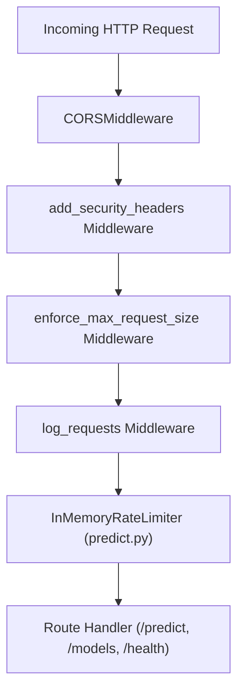

# ⚙️ Backend Architecture & Service Pipeline

> [!INFO] Related Documents
> * Back to [[Index|Vault Home]]
> * [[System Architecture]]
> * [[API Specification]]
> * [[Model Overview]]
> * [[Inference Service]]
> * [[Security Guidelines]]

---

## 🏗️ Architecture Overview

The backend is built with **FastAPI** running on an asynchronous **Uvicorn** ASGI server. It handles HTTP REST endpoints, multi-model image file validation pipelines, rate limiting, and dual-singleton PyTorch model inference (`EfficientNet-B0` and `ForensicNet`).

---

## 🧠 Backend Dual-Model Serving Architecture

The diagram below documents the full lifecycle from server startup and lifespan singleton model loading to incoming request model resolution and timed forward pass execution.

```mermaid
graph TD
    subgraph Server Startup & Lifespan Phase
        Startup["FastAPI Application Startup (@asynccontextmanager lifespan)"] --> Init["initialize_models() in inference.py"]
        Init --> LoadEff["Load EfficientNet-B0 Weights (best_efficientnet_b0.pth)"]
        Init --> LoadFor["Load ForensicNet Weights (best_forensicnet.pth)"]
        LoadEff --> StoreEff["_models['efficientnet'] Singleton (4.66M params)"]
        LoadFor --> StoreFor["_models['forensicnet'] Singleton (1.05M params)"]
    end

    subgraph Runtime Request Processing Phase
        Request["Incoming POST /api/v1/predict (multipart/form-data)"] --> ExtractModel["resolve_model_choice(model, request)"]
        ExtractModel --> InspectVal{"model choice"}
        InspectVal -- "'efficientnet' (default)" --> RouteEff["Fetch _models['efficientnet'] Instance"]
        InspectVal -- "'forensicnet'" --> RouteFor["Fetch _models['forensicnet'] Instance"]
        RouteEff --> ForwardPass["run_forward_pass(model, tensor, device)"]
        RouteFor --> ForwardPass
        ForwardPass --> FormatResp["Construct PredictionResponse Schema"]
        FormatResp --> Response["200 OK Response (label, confidence, model_used, model_display_name)"]
    end
```


* 🖼️ Static Image Fallback: [[../assets/diagrams/02-backend-dual-model-serving.png|Static PNG version (02-backend-dual-model-serving.png)]]

---

## 🛡️ Middleware Chain (`backend/app/main.py`)

Every incoming HTTP request passes through a sequence of middleware handlers before reaching API routes:



### Middleware Details

1. **`CORSMiddleware`:**
   * Origin lockdown configured via `ALLOWED_ORIGINS` environment variable (defaults strictly to `http://localhost:3000`).
2. **`add_security_headers`:**
   * Injects security response headers: `X-Content-Type-Options: nosniff`, `X-Frame-Options: DENY`, `X-XSS-Protection: 1; mode=block`.
3. **`enforce_max_request_size`:**
   * Rejects requests exceeding **10MB** for single predictions or **110MB** for batch predictions with HTTP 413.
4. **`log_requests`:**
   * Logs HTTP method, URL path, client IP, status code, and latency to `backend/logs/app.log`.
5. **`InMemoryRateLimiter`:**
   * Sliding-window rate limiter checking client IP (30 req/min for single, 5 req/min for batch).

---

## 🧠 Dual-Model Initialization & Lifespan Code (`backend/app/main.py` & `backend/app/services/inference.py`)

FastAPI uses an `@asynccontextmanager` lifespan handler to load both models into memory on server startup:

```python
@asynccontextmanager
async def lifespan(app: FastAPI):
    logger.info("Initializing ML model services on application startup...")
    try:
        statuses = initialize_models()
        logger.info(f"ML Models initialization complete: {statuses}")
    except Exception as e:
        logger.error(f"Failed to initialize models during startup: {e}")
    yield
    logger.info("Shutting down application...")
```

`initialize_models()` instantiates both `EfficientNet-B0` (4.66M params) and `ForensicNet` (1.05M params), loads weights from `backend/ml/model_weights/`, computes exact parameter counts dynamically via `model.parameters()`, and logs combined VRAM/RAM memory consumption (~22.6 MB).

---

## 📡 API Routing & Model Resolution (`backend/app/routes/predict.py`)

1. **GET `/api/v1/models`:** Dynamically returns model metadata, test accuracy, AUC-ROC, live computed parameter counts, and load status.
2. **POST `/api/v1/predict`:** Accepts image binary and optional `model` parameter (`"efficientnet"` or `"forensicnet"`). `resolve_model_choice()` validates the model ID and routes inference to the specified model instance in `inference.py`.

---

## 📂 Static Production Build Serving

If `frontend/dist` exists, `main.py` mounts a catch-all route `/{file_name:path}` to serve the production React SPA with path traversal security checks:

```python
if file_name.startswith("api/") or file_name == "health":
    raise HTTPException(status_code=404, detail="Not Found")
file_path = os.path.abspath(os.path.join(frontend_dist_dir, file_name))
if not file_path.startswith(frontend_dist_dir):
    raise HTTPException(status_code=403, detail="Access Denied")
```

---

## 🔗 Next Steps
* Detailed endpoint schemas are documented in [[API Specification]].
* PyTorch model execution logic is covered in [[Inference Service]] and [[Model Overview]].
