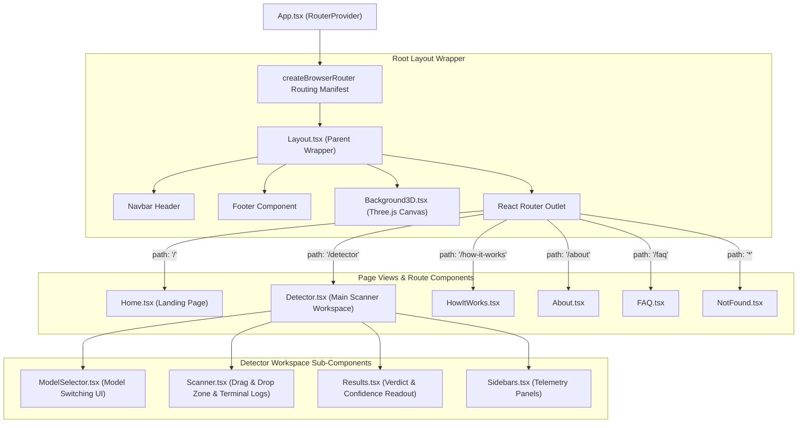

# 💻 Frontend Architecture & UI Component Design

> [!INFO] Related Documents
> * Back to [[Index|Vault Home]]
> * [[System Architecture]]
> * [[Design System & Theme]]
> * [[Scanner Component]]
> * [[Results Component]]
> * [[ModelSelector Component]]

---

## 🏗️ Architecture Overview

The frontend is a single-page application (SPA) built with **React 19**, **TypeScript**, and **Vite 8**. It adheres to a cyberpunk visual aesthetic with glassmorphic cards, glowing neon elements, dynamic Three.js particle graphics, and real-time terminal scan logs.

---

## 🗺️ Client Site Map & Route Hierarchy (`App.tsx`)

Routing is managed via **React Router v7** using `createBrowserRouter`. All top-level routes are rendered inside `Layout.tsx`, which supplies shared navigation headers, background graphics, and footers.


* 🖼️ Static Image Fallback: [[../assets/diagrams/03-frontend-sitemap.png|Static PNG version (03-frontend-sitemap.png)]]

---

## 🧱 Component Tree & Responsibilities

1. **[[ModelSelector Component]] (`ModelSelector.tsx`):**
   * Exclusively mounted on the `DetectorPage`.
   * Renders interactive model switching pill buttons (`EfficientNet-B0` vs `ForensicNet`).
2. **[[Scanner Component]] (`Scanner.tsx`):**
   * Manages file drag-and-drop zone.
   * Simulates step-by-step terminal log execution during scan pass.
3. **[[Results Component]] (`Results.tsx`):**
   * Displays final verdict (`AI Generated` in red or `Real` in green).
   * Renders confidence score progress meter, execution time, and `model_used` telemetry.
4. **[[Background3D Component]] (`Background3D.tsx`):**
   * Renders interactive Three.js 3D particle canvas background responding to mouse movements.
5. **`Layout.tsx`:**
   * Global page wrapper providing persistent navigation, header titles, and footer links.
6. **`ErrorBoundary.tsx`:**
   * Catches runtime UI errors gracefully and provides visual recovery fallbacks.

---

## 🎨 Styling System & Theme Tokens

Styling combines **Tailwind CSS v4** (`@tailwindcss/vite`) with custom CSS variables defined in `frontend/src/styles/theme.css`:

```css
/* Core Theme Tokens */
--color-bg-color: #0b0c10;
--color-primary-cyan: #66fcf1;
--color-secondary-cyan: #45a29e;
--color-accent-red: #ff4136;
--color-accent-green: #2ecc40;
--font-terminal: 'JetBrains Mono', monospace;
--font-display: 'Orbitron', sans-serif;
```

> [!NOTE] Design Rules
> All new UI components must strictly consume existing tokens from `theme.css`. See [[Design System & Theme]] for full visual standards.

---

## 🔌 API Service Layer (`frontend/src/services/api.ts`)

API interactions are encapsulated in `api.ts`, exposing typed helper functions:
* `checkBackendHealth()` -> `GET /health`
* `fetchModels()` -> `GET /api/v1/models`
* `predictSingleImage(file, model)` -> `POST /api/v1/predict`
* `predictBatchImages(files, model)` -> `POST /api/v1/predict/batch`
