# ⚖️ Model Comparison — EfficientNet-B0 vs ForensicNet

> [!INFO] Related Documents
> * Parent Overview: [[Model Overview]]
> * Semantic Model: [[EfficientNet-B0]]
> * Forensic Noise Model: [[ForensicNet]]
> * Success Metrics: [[Success Metrics & Evaluation]]
> * Training Pipelines: [[Training & Fine-Tuning Pipeline]]

---

## 📊 Comprehensive Side-by-Side Comparison Table

All metrics below are generated directly by running `backend/ml/compare_models.py`, which reads evaluation results (`evaluation_results.json` & `evaluation_results_forensicnet.json`) and computes live model parameter counts directly from PyTorch architecture definitions.

| Metric | EfficientNet-B0 (Transfer Learning) | ForensicNet (Custom Tri-Stream) | Metric Winner |
| :--- | :--- | :--- | :--- |
| **Model Architecture** | CNN (ImageNet-1K Backbone) | Custom (Bayar Noise + 2D FFT + RGB) | N/A |
| **Test Accuracy** | **97.82%** (`0.9782`) | **94.83%** (`0.9483`) | **EfficientNet-B0** |
| **AUC-ROC Score** | **0.9979** | **0.9903** | **EfficientNet-B0** |
| **Macro Precision** | **97.82%** (`0.9782`) | **94.83%** (`0.9483`) | **EfficientNet-B0** |
| **Macro Recall** | **97.82%** (`0.9782`) | **94.84%** (`0.9484`) | **EfficientNet-B0** |
| **Macro F1-Score** | **97.82%** (`0.9782`) | **94.83%** (`0.9483`) | **EfficientNet-B0** |
| **GPU Inference Speed** | **3.78 ms** | **1.78 ms** | **ForensicNet** (2.1x faster) |
| **CPU Inference Speed** | **12.24 ms** | **85.76 ms** | **EfficientNet-B0** (7.0x faster) |
| **Trainable Parameters** | **4,664,446** (`4.66M`) | **1,048,942** (`1.05M`) | **ForensicNet** (4.4x smaller) |
| **Training Duration** | 540.7 min (40 Epochs) | 535.8 min (40 Epochs) | **ForensicNet** |
| **Model Weights File** | `best_efficientnet_b0.pth` | `best_forensicnet.pth` | N/A |

---

## ⚡ Key Technical Finding: The CPU vs GPU Hardware Paradox

> [!IMPORTANT] Hardware Benchmark Insight
> A critical empirical finding from the benchmark comparison is that **ForensicNet is dramatically slower on CPU (85.76 ms) than EfficientNet-B0 (12.24 ms)**, despite ForensicNet having a **4.4x smaller parameter footprint** (1.05M vs 4.66M).

```mermaid
gantt
    title Latency Breakdown Across Hardware Architectures
    dateFormat  X
    axisFormat %s ms
    section GPU (NVIDIA CUDA)
    ForensicNet (1.78 ms)        : active, 0, 2
    EfficientNet-B0 (3.78 ms)    : active, 0, 4
    section CPU (Host Processor)
    EfficientNet-B0 (12.24 ms)   : done, 0, 12
    ForensicNet (85.76 ms)       : crit, 0, 86
```

### Root Cause Analysis: FFT Computation Overhead
* **GPU Parallel Acceleration:** On CUDA GPUs, 2D Fast Fourier Transforms (`torch.fft.fft2`) and 2D magnitude spectrum shifts (`torch.fft.fftshift`) execute in parallel across thousands of CUDA cores, completing in under **1.78 ms**.
* **CPU Host Bottleneck:** On CPU host processors, 2D Discrete Fourier Transforms require sequential $\mathcal{O}(N \log N)$ complex matrix math per channel and explicit spatial array reallocation during `fftshift`. This introduces significant computational overhead on host CPU cores that dominates forward pass execution time.

---

## 🎯 Deployment Guidelines & Recommendations

### 1. Edge & High-Throughput GPU Deployments $\rightarrow$ Choose [[ForensicNet]]
* **Ideal For:** Servers equipped with CUDA GPUs, low-memory edge devices, or high-concurrency API endpoints.
* **Why:** Delivers ultra-low latency (**1.78 ms** per image), consumes only **1.05M parameters**, and analyzes low-level noise/frequency artifacts invisible to standard CNN backbones.

### 2. CPU-Only Host Deployments $\rightarrow$ Choose [[EfficientNet-B0]]
* **Ideal For:** Cloud instances lacking dedicated GPUs (e.g. basic EC2/Docker containers), desktop environments, or applications requiring peak classification accuracy.
* **Why:** Achieves superior accuracy (**97.82%**) and processes images in **12.24 ms** on host CPUs without FFT bottlenecking.

---

## 🔗 References & Links
* Parent overview: [[Model Overview]]
* Transfer model: [[EfficientNet-B0]]
* Custom noise model: [[ForensicNet]]
* Official metrics: [[Success Metrics & Evaluation]]
