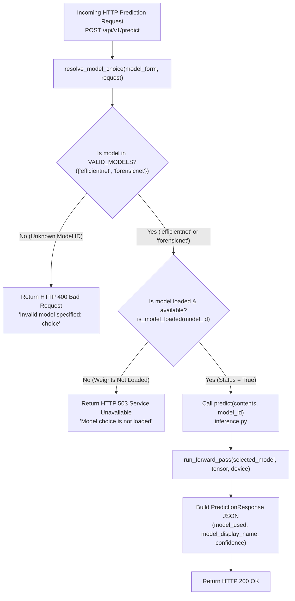

# 🧠 Model Overview & Dual-Model Serving Strategy

> [!INFO] Related Documents
> * Back to [[Index|Vault Home]]
> * Comparative Analysis: [[Model Comparison]]
> * Semantic Model: [[EfficientNet-B0]]
> * Forensic Noise Model: [[ForensicNet]]
> * Inference Service: [[Inference Service]]
> * API Specification: [[API Specification]]

---

## 🎯 Architecture & Dual-Model Rationale

The Neural Forensic Engine employs a **dual-model serving strategy** designed to provide complementary classification perspectives. Rather than relying solely on a single vision backbone, the application hosts two distinct model architectures simultaneously in memory:

1. **[[EfficientNet-B0]] (Semantic Transfer Learning):**
   - **Focus:** High-level semantic features, object plausibility, lighting consistency, and fine details.
   - **Key Advantage:** Industry-leading accuracy (**97.82%**) and excellent CPU inference latency (**12.24 ms**).
2. **[[ForensicNet]] (Custom Noise/Frequency Domain Analysis):**
   - **Focus:** Microscopic pixel residual noise (Bayar constrained filters) and periodic spectral artifacts (2D FFT log-magnitude spectrum).
   - **Key Advantage:** Extremely lightweight (**1.05M parameters**, 4.4x smaller footprint) and ultra-fast GPU inference (**1.78 ms**).

---

## 🔀 Model Selection & Routing Decision Flow

The flowchart below documents how incoming HTTP prediction requests are validated, checked for model availability, and dispatched to the active PyTorch model instance in `backend/app/routes/predict.py`.


* 🖼️ Static Image Fallback: [[../assets/diagrams/09-model-selection-decision-flow.png|Static PNG version (09-model-selection-decision-flow.png)]]

---

## 🔄 Dual-Model Lifecycle & Serving Architecture (`backend/app/services/inference.py`)

Both models are initialized during FastAPI application startup via an `@asynccontextmanager` lifespan handler:

```
                          FastAPI Application Startup
                                       │
                                       ▼
                       ┌───────────────────────────────┐
                       │  initialize_models()          │
                       └───────────────┬───────────────┘
                                       │
                ┌──────────────────────┴──────────────────────┐
                ▼                                             ▼
  ┌───────────────────────────┐                 ┌───────────────────────────┐
  │  Load EfficientNet-B0     │                 │  Load ForensicNet         │
  │  Weights: best_b0.pth     │                 │  Weights: best_fn.pth     │
  │  Params: 4.66M            │                 │  Params: 1.05M            │
  └─────────────┬─────────────┘                 └─────────────┬─────────────┘
                │                                             │
                └──────────────────────┬──────────────────────┘
                                       ▼
                       ┌───────────────────────────────┐
                       │ Models Loaded in RAM/VRAM     │
                       │ Combined Footprint: ~22.6 MB  │
                       └───────────────┬───────────────┘
                                       │
                                       ▼
                       ┌───────────────────────────────┐
                       │  Client Model Selector Route  │
                       │  POST /api/v1/predict?model=  │
                       └───────────────────────────────┘
```

---

## 📋 Quick Model Specification Comparison

| Specification | EfficientNet-B0 | ForensicNet |
| :--- | :--- | :--- |
| **Detection Paradigm** | Semantic / Transfer Learning | Pixel Residuals + 2D FFT Frequency |
| **Test Accuracy** | **97.82%** | **94.83%** |
| **AUC-ROC** | **0.9979** | **0.9903** |
| **Trainable Parameters** | **4,664,446** (`4.66M`) | **1,048,942** (`1.05M`) |
| **GPU Inference Latency** | **3.78 ms** | **1.78 ms** (Winner) |
| **CPU Inference Latency** | **12.24 ms** (Winner) | **85.76 ms** |
| **Weights File** | `best_efficientnet_b0.pth` | `best_forensicnet.pth` |
| **Dedicated Note** | [[EfficientNet-B0]] | [[ForensicNet]] |

---

## 🔗 Next Steps & Deep Dives
* Full side-by-side performance comparison: [[Model Comparison]].
* Detailed notes: [[EfficientNet-B0]] and [[ForensicNet]].
* Backend service details: [[Inference Service]].
