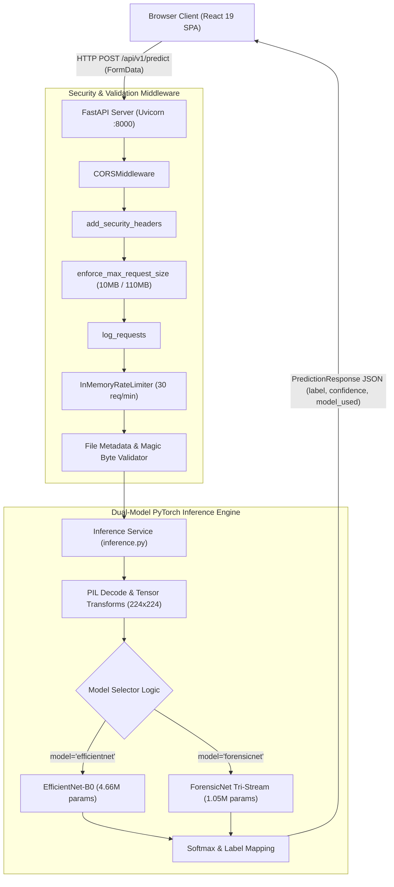

# 🏗️ System Architecture & Technology Stack

> [!INFO] Related Documents
> * Back to [[Index|Vault Home]]
> * [[Frontend Architecture]]
> * [[Backend Architecture]]
> * [[API Specification]]
> * [[Model Overview]]
> * [[Model Comparison]]

---

## 📡 End-to-End System Overview

The **AI Image Detector** system follows a decoupled client-server architecture. The frontend is built as a single page application (SPA) using React 19 and Vite. The backend is powered by FastAPI running on Uvicorn, serving dual PyTorch ML inference models (**EfficientNet-B0** and **ForensicNet**).

* 🖼️ Static Image Fallback: [[../assets/diagrams/01-system-architecture.png|Static PNG version (01-system-architecture.png)]]

---

## 🧰 Technology Stack Summary

| Domain | Technology | Key Usage / Package |
| :--- | :--- | :--- |
| **Frontend Framework** | React 19 + TypeScript | Component UI rendering, state management |
| **Frontend Build Tool** | Vite 8 | Fast HMR, production static bundling |
| **Frontend Styling** | Tailwind CSS v4 + Vanilla CSS | Utility classes and custom theme tokens in `theme.css` |
| **3D & Graphics** | Three.js | Interactive particle canvas (`Background3D.tsx`) |
| **Backend Framework** | FastAPI (Python 3.10+) | Async REST API endpoints, routing, middleware |
| **ASGI Server** | Uvicorn | High-performance server runner |
| **ML Framework** | PyTorch & Torchvision | Dual inference (EfficientNet-B0 & ForensicNet) & training pipelines |
| **Image Processing** | Pillow (PIL) | In-memory binary image decoding & integrity checks |
| **Metrics & Plotting** | Scikit-Learn / Matplotlib / Seaborn | Evaluation metrics, confusion matrix, ROC plots |

---

## 🔄 End-to-End Execution Trace

1. **User Upload & Model Selection:** User drops an image into [[Scanner Component]] (`DetectorPage`) and selects active model (`EfficientNet-B0` or `ForensicNet`).
2. **API Request:** Frontend API client (`api.ts`) sends multipart HTTP POST request to `POST /api/v1/predict` with image file and model selector parameter.
3. **Middleware Processing:**
   * `enforce_max_request_size`: Verifies `Content-Length` <= 10MB.
   * `rate_limiter`: Checks client IP (max 30 req/min).
   * `add_security_headers`: Attaches `nosniff`, `DENY`, `1; mode=block`.
4. **Validation:** `validate_file_metadata` checks extensions (`.jpg`, `.png`, `.webp`) and `validate_image_magic_bytes` checks initial header bytes (`FF D8 FF`, `\x89PNG`, `RIFF...WEBP`).
5. **Inference Execution:** Image bytes decoded via PIL, normalized to $(1, 3, 224, 224)$, and routed to selected singleton model (`best_efficientnet_b0.pth` or `best_forensicnet.pth`).
6. **Response:** Returns `PredictionResponse` JSON containing label (`AI Generated` or `Real`), confidence float (`0.0 - 1.0`), `inference_time_ms`, `model_used`, and `model_display_name`.

---

## 🔗 Next Steps
* Read frontend specifics in [[Frontend Architecture]].
* Read backend middleware & routes in [[Backend Architecture]].
* Explore model comparison in [[Model Comparison]].
