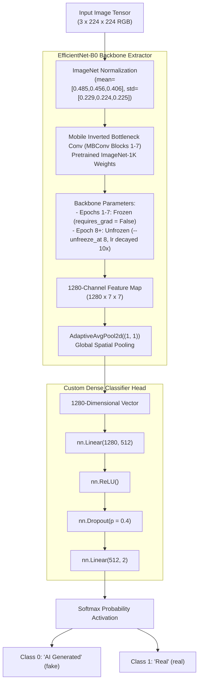

# 🤖 EfficientNet-B0 — Semantic Transfer Learning Model

> [!INFO] Related Documents
> * Parent Overview: [[Model Overview]]
> * Comparison: [[Model Comparison]]
> * Peer Model: [[ForensicNet]]
> * Training Pipeline: [[Training & Fine-Tuning Pipeline]]
> * Benchmark Diagnostics: [[Evaluation & Benchmark Results]]

---

## 📐 Architecture Breakdown & Diagram

EfficientNet-B0 serves as the primary transfer learning model for semantic classification. It leverages Mobile Inverted Bottleneck Convolution (MBConv) blocks pretrained on ImageNet-1K, paired with a custom dense classification head.


* 🖼️ Static Image Fallback: [[../assets/diagrams/07-efficientnet-b0-architecture.png|Static PNG version (07-efficientnet-b0-architecture.png)]]

---

## 💻 PyTorch Definition (`backend/app/services/inference.py` & `backend/ml/train.py`)

```python
import torch.nn as nn
from torchvision import models

def build_efficientnet_b0(num_classes: int = 2) -> nn.Module:
    weights = models.EfficientNet_B0_Weights.IMAGENET1K_V1
    model = models.efficientnet_b0(weights=weights)

    # Freeze backbone initially for transfer learning phase
    for param in model.parameters():
        param.requires_grad = False

    # Replace default 1000-class classifier head
    model.classifier = nn.Sequential(
        nn.Linear(1280, 512),
        nn.ReLU(),
        nn.Dropout(0.4),
        nn.Linear(512, num_classes)
    )
    return model
```

---

## 🎓 Training Strategy & Transfer Learning Approach

1. **Two-Phase Transfer Learning:**
   - **Phase 1 (Epochs 1–7):** Backbone weights are frozen (`requires_grad = False`). Only the newly attached 512-dim classifier head is trained using AdamW optimizer with learning rate $\eta = 1\times 10^{-3}$.
   - **Phase 2 (Epoch 8+):** All backbone layers are unfrozen (`--unfreeze_at 8`). The learning rate is reduced to $\eta = 1\times 10^{-4}$ ($10\times$ smaller) to avoid catastrophic forgetting of pretrained visual features.
2. **Loss & Optimization:** Cross-Entropy Loss with Automatic Mixed Precision (`torch.cuda.amp.autocast`) and `ReduceLROnPlateau` scheduler.
3. **Data Augmentations:** `Resize(256)` -> `RandomCrop(224)` -> `RandomHorizontalFlip` -> `RandomRotation(degrees=10)` -> ImageNet Normalization (`mean=[0.485, 0.456, 0.406]`, `std=[0.229, 0.224, 0.225]`).

---

## 📊 Final Measured Metrics (`evaluation_results.json`)

* **Test Accuracy:** **97.82%** (`0.9782`)
* **AUC-ROC Score:** **0.9979**
* **Macro Precision:** **97.82%**
* **Macro Recall:** **97.82%**
* **Macro F1-Score:** **97.82%**
* **GPU Inference Latency:** **3.78 ms** per image
* **CPU Inference Latency:** **12.24 ms** per image
* **Total Parameters:** **4,664,446** (`4.66M` counted live via `model.parameters()`)
* **Weights Path:** `backend/ml/model_weights/best_efficientnet_b0.pth`

---

## 🔗 References & Links
* Parent overview: [[Model Overview]]
* Comparative benchmark: [[Model Comparison]]
* Custom noise/frequency model: [[ForensicNet]]
