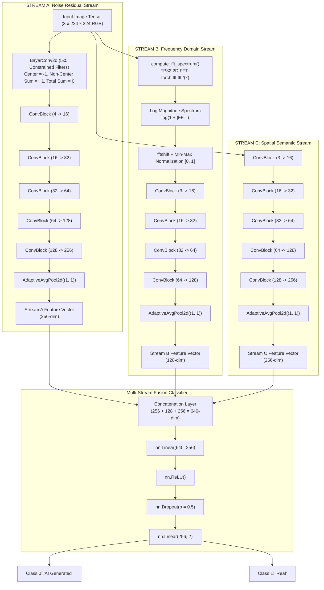

# 🔬 ForensicNet — Custom Multi-Stream Forensic Model

> [!INFO] Related Documents
> * Parent Overview: [[Model Overview]]
> * Comparison: [[Model Comparison]]
> * Peer Model: [[EfficientNet-B0]]
> * Training History: [[Model Version History]]
> * Bug Diagnosis & Fix: [[Known Issues & Resolved Bugs]]

---

## 📐 Forensic Rationale & Multi-Stream Architecture Diagram

ForensicNet is a custom tri-stream neural network designed specifically for synthetic image detection. Unlike general-purpose CNN backbones that rely heavily on high-level semantic shapes, ForensicNet explicitly isolates high-frequency noise residuals and frequency domain artifacts created by GAN transposed convolutions and diffusion upsampling filters.


* 🖼️ Static Image Fallback: [[../assets/diagrams/08-forensicnet-architecture.png|Static PNG version (08-forensicnet-architecture.png)]]

### Stream Definitions (`backend/ml/custom_model.py`)

1. **Stream A (Bayar Constrained Noise Stream):**
   - Uses `BayarConv2d` (5x5 filters).
   - **Constraint Formula:** Center weight $w(2,2) = -1.0$; all 24 non-center weights are normalized to sum to $+1.0$. Total filter sum equals zero ($\sum w = 0$).
   - **Rationale:** Suppresses underlying scene semantics and forces the network to process pixel prediction-error residuals (sensor noise and synthesis artifacts).
2. **Stream B (Frequency Domain Stream):**
   - Transforms input tensor to 2D log-magnitude spectrum: $S = \log(1 + |\mathcal{F}(x)|)$.
   - Applies `torch.fft.fftshift` to center the zero-frequency DC component and min-max normalizes to $[0, 1]$.
   - **Rationale:** Captures periodic grid artifacts left by transposed convolutions or bilinear upsampling.
3. **Stream C (Spatial/Semantic Stream):**
   - Standard 5-layer CNN processing raw RGB pixels.
   - **Rationale:** Supplies global spatial context (e.g. anatomical distortions, impossible lighting).
4. **Fusion Classifier Head:**
   - Concatenates vectors from Stream A (256), Stream B (128), Stream C (256) into a 640-dim feature vector.
   - Passes through `Linear(640, 256)` -> `ReLU` -> `Dropout(p=0.5)` -> `Linear(256, 2)`.

---

## 🎓 From-Scratch Training Strategy (`backend/ml/train_custom.py`)

* **Weights Initialization:** Trained completely from scratch (Xavier uniform initialization for `BayarConv2d` and ConvBlocks).
* **Epochs & Schedule:** 40 epochs with `CosineAnnealingLR` (base $\eta = 5\times 10^{-4}$, minimum $\eta = 1\times 10^{-6}$).
* **Gentle Forensic Augmentations:** Designed to preserve fragile noise and frequency signatures:
  - `Resize(240)` -> `RandomCrop(224)` -> `RandomHorizontalFlip` -> `RandomRotation(degrees=5)`.
* **Hardware Optimizations:** Pinned memory, `persistent_workers=True`, `prefetch_factor=4`, Ampere TF32 acceleration (`allow_tf32=True`).

---

## ⚠️ The NaN Crash & Technical Solution

### The Issue (Run 1)
During the initial training run (`train_custom.py`), the model trained normally through Epoch 3 (val accuracy 91.42%), but suddenly suffered a total loss explosion to `NaN` at Epoch 4.

### Root Cause Analysis
1. **FP16 Overflow in FFT Min-Max Normalization:** Under Automatic Mixed Precision (`torch.cuda.amp.autocast`), `(shifted_spectrum - amin) / (amax - amin + 1e-6)` performed in FP16 produced underflow/overflow values near zero, generating `NaN` outputs.
2. **In-Place Bayar Parameter Mutation:** `BayarConv2d` originally mutated `self.conv.weight.data` in-place inside the forward pass, breaking PyTorch autograd computational graphs and `GradScaler` state tracking.
3. **Unbounded Gradient Multi-Stream Accumulation:** Gradients from three parallel streams accumulated without clipping, causing gradient explosion.

### The Fix Applied
1. **FP32 Forced Execution Block:** FFT computation is explicitly wrapped to run in float32 with autocast disabled:
   ```python
   with torch.autocast(device_type=device_type, enabled=False):
       x_f32 = x.float()
       fft_result = torch.fft.fft2(x_f32, dim=(-2, -1))
       # ... compute log magnitude ...
       normalized_spectrum = (shifted_spectrum - amin) / (amax - amin + 1e-6)
       normalized_spectrum = torch.clamp(normalized_spectrum, 0.0, 1.0)
   ```
2. **Non-In-Place Weight Constraining:** Modified `constrain_weights()` to construct a new functional tensor using multiplicative masking without mutating `self.conv.weight.data` in-place.
3. **Gradient Norm Clipping:** Added `torch.nn.utils.clip_grad_norm_(model.parameters(), max_norm=1.0)` prior to optimizer step.
4. **Learning Rate & Safeguards:** Lowered initial learning rate to `5e-4` and implemented automated `NaN` detection with state rollback.

### Verification
A 3-epoch smoke test verified clean loss convergence without `NaN` occurrences before running the complete 40-epoch training pipeline.

---

## 📊 Final Measured Metrics (`evaluation_results_forensicnet.json`)

* **Test Accuracy:** **94.83%** (`0.9483`)
* **AUC-ROC Score:** **0.9903**
* **Macro Precision:** **94.83%**
* **Macro Recall:** **94.84%**
* **Macro F1-Score:** **94.83%**
* **GPU Inference Latency:** **1.78 ms** per image (2.1x faster than EfficientNet-B0)
* **CPU Inference Latency:** **85.76 ms** per image (CPU bottlenecked by FFT calculations)
* **Total Parameters:** **1,048,942** (`1.05M` counted live via `model.parameters()`)
* **Weights Path:** `backend/ml/model_weights/best_forensicnet.pth`

---

## 🔗 References & Links
* Parent overview: [[Model Overview]]
* Comparative benchmark: [[Model Comparison]]
* Semantic transfer model: [[EfficientNet-B0]]
* Training & bug resolution: [[Known Issues & Resolved Bugs]]
