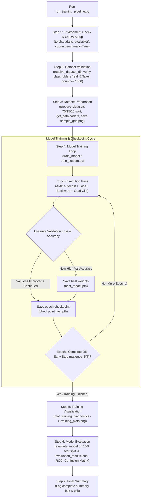
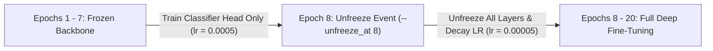

# 🚀 Training & Fine-Tuning Pipeline

> [!INFO] Related Documents
> * Back to [[Index|Vault Home]]
> * [[ML Model Architecture]]
> * [[EfficientNet-B0]]
> * [[ForensicNet]]
> * [[Dataset Management]]
> * [[Evaluation & Benchmark Results]]

---

## 📋 Training Overview

The automated end-to-end training pipeline is orchestrated via `backend/ml/run_training_pipeline.py` (or `backend/ml/train_custom.py` for ForensicNet). It executes a 7-step sequence spanning hardware detection, dataset split validation, checkpointed training loops, diagnostic plotting, and test dataset evaluation.

---

## 🔄 End-to-End Automated Pipeline Flowchart


* 🖼️ Static Image Fallback: [[../assets/diagrams/10-training-pipeline.png|Static PNG version (10-training-pipeline.png)]]

---

## 🔄 Two-Stage Fine-Tuning Strategy (EfficientNet-B0)



1. **Stage 1 (Epochs 1 – 7):**
   * Backbone parameters are frozen (`requires_grad = False`).
   * Only parameters in `model.classifier` are updated.
   * Initial learning rate: `lr = 0.0005`.
2. **Stage 2 (Epoch 8 Onward):**
   * Triggered by `--unfreeze_at 8`.
   * All backbone layers are unfrozen (`requires_grad = True`).
   * Optimizer learning rate is scaled down by `0.1` (`lr = 0.00005`) to prevent catastrophic forgetting.

---

## ⚙️ Hyperparameters & Optimization

| Hyperparameter | EfficientNet-B0 Value | ForensicNet Value | Description |
| :--- | :--- | :--- | :--- |
| **Optimizer** | `Adam` | `AdamW` | Initial `lr = 0.0005`, `weight_decay = 1e-4` |
| **LR Scheduler** | `ReduceLROnPlateau` | `CosineAnnealingLR` | Step per epoch decay |
| **Loss Function** | `CrossEntropyLoss` | `CrossEntropyLoss` | Binary cross-entropy classification loss |
| **Mixed Precision** | `torch.cuda.amp` | `torch.cuda.amp` (FP32 FFT block) | Reduces VRAM footprint |
| **Early Stopping** | 5 Epochs | 8 Epochs | Triggers if validation loss fails to improve |
| **Batch Size** | `32` | `32` | Standard training batch size |
| **Data Workers** | 2 | 6 | DataLoader worker threads |

---

## 🏃 Running the Automated Pipeline

> [!TIP] Pipeline Runner Commands
> ```bash
> # Run complete end-to-end pipeline (CUDA check -> dataset validation -> train -> plot -> evaluate)
> python backend/ml/run_training_pipeline.py --data_path ./data --unfreeze_at 8
> 
> # Run ForensicNet Custom Training
> backend/.venv/bin/python3 backend/ml/train_custom.py --epochs 40 --batch_size 32
> ```

---

## 💾 Checkpointing & Saved Artifacts

* **Best Model Weights:** `backend/ml/model_weights/best_efficientnet_b0.pth` and `best_forensicnet.pth`.
* **Last Epoch Checkpoint:** `backend/ml/model_weights/checkpoint_last.pth` (saved at the end of every epoch for seamless training resumption).
* **Training History Log:** `backend/ml/training_log.json` and `training_log_forensicnet.json`.
* **Diagnostic Plots:** `backend/ml/training_plots.png`.
