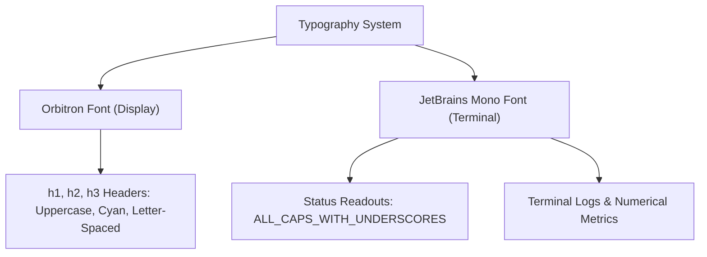

# 🎨 Design System & Visual Style Guide

> [!INFO] Related Documents
> * Back to [[Index|Vault Home]]
> * [[Development Rules]]
> * [[Frontend Architecture]]
> * [[Scanner Component]]
> * [[Results Component]]

---

## 👁️ Design Philosophy

The application employs a **premium, high-fidelity cyberpunk terminal aesthetic** reminiscent of a military-grade forensic scanning interface. Key visual signatures include high-contrast neon glows, monospace telemetry logs, scanline overlays, 3D tilted glassmorphic panels, and data-dense readouts.

---

## 🎨 Color Palette & CSS Tokens (`DESIGN.md`, `theme.css`, `theme.js`)

```css
@theme {
  /* Core Base & Signature Colors */
  --color-primary-ink: #171717;         /* Ink dark background */
  --color-bg-color: #0b0c10;            /* Dark Navy Base Void */
  --color-primary-cyan: #50e3c2;        /* Primary Signature Cyan Glow */
  --color-secondary-cyan: #29bc9b;      /* Dimmed Teal Accents */
  --color-text-grey: #c5c6c7;           /* Body Text Muted Grey */
  --color-text-white: #ffffff;          /* High-contrast Headers */
  
  /* Status Accent Glows */
  --color-accent-red: #ee0000;          /* AI Generated Alert / Red */
  --color-accent-red-glow: #c50000;     /* Red Glow Effect */
  --color-accent-green: #2ecc40;        /* Real Photograph / Green */
  --color-accent-green-glow: #00ffcc;   /* Green Glow Effect */
  --color-warning-yellow: #f5a623;      /* Initialization / Warnings */
  
  /* Panel Background Opacities */
  --color-panel-bg: rgba(11, 12, 16, 0.7);
  --color-panel-bg-logs: #000000;
  --color-panel-bg-results: rgba(0, 0, 0, 0.85);
  
  /* Typography Fonts */
  --font-terminal: 'Geist Mono', 'JetBrains Mono', monospace;
  --font-display: 'Geist', 'Inter', 'Orbitron', system-ui, sans-serif;
}
```

---

## 🔤 Typography Guidelines



> [!EXAMPLE] System Label Formatting
> * ✅ `SYSTEM_INITIALIZED`
> * ✅ `FORWARD_PASS_EXECUTION`
> * ❌ `System Initialized`

---

## 🖼️ Panel Borders, Radii & Shadows

* **Borders:** `1px solid rgba(102, 252, 241, 0.2)`
* **Corner Radii:**
  * Tactical Sidebars: `0px` (Sharp corners)
  * Results Container: `8px` (`--radius-panel`)
  * Image Hologram Wrappers: `4px` (`--radius-hologram`)
* **Glow Shadows:**
  * Interactive Cyan Glow: `box-shadow: 0 0 15px #66fcf1`
  * Hologram Container: `box-shadow: 0 0 30px rgba(102, 252, 241, 0.2)`

---

## ✨ Micro-Interactions & Visual Effects

1. **3D Tilt Perspective:** Cards shift angle (`rotateX(2deg) rotateY(-2deg)`) and elevate on mouse hover.
2. **Scanline Grid:** Repeating background scanlines (`rgba(102, 252, 241, 0.05)`) provide CRT monitor aesthetics.
3. **Interactive 3D Particles:** Three.js particle system in [[Background3D Component]] reacts to mouse movement.
