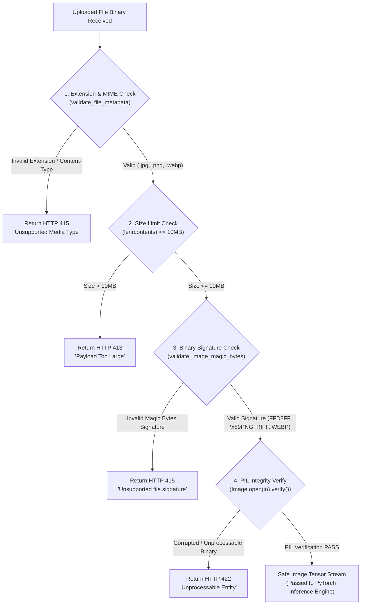

# 🛡️ Security Guidelines & Defense Mechanisms

> [!INFO] Related Documents
> * Back to [[Index|Vault Home]]
> * [[Development Rules]]
> * [[Backend Architecture]]
> * [[API Specification]]

---

## 🔒 Multi-Layered Security Architecture

The backend implements defensive security mechanisms to prevent file upload exploits, Denial of Service (DoS) attacks, cross-site scripting (XSS), and CORS hijacking.

---

## 📋 Comprehensive File Validation Decision Flow

The flowchart below documents the multi-stage security validation pipeline executed on every incoming image payload in `backend/app/routes/predict.py` and `backend/app/utils/security.py`. Each rejection node shows the exact HTTP status code returned to clients.


* 🖼️ Static Image Fallback: [[../assets/diagrams/06-file-validation-flow.png|Static PNG version (06-file-validation-flow.png)]]

---

## 1. Binary Magic Byte Validation (`validate_image_magic_bytes`)

Defined in `backend/app/utils/security.py`. Rejects files that spoof extensions by checking initial header signatures:

```python
def validate_image_magic_bytes(file_bytes: bytes) -> bool:
    if not file_bytes or len(file_bytes) < 12:
        return False

    # Check JPEG magic bytes: FF D8 FF
    if file_bytes.startswith(b'\xff\xd8\xff'):
        return True

    # Check PNG magic bytes: \x89PNG
    if file_bytes.startswith(b'\x89PNG') or file_bytes.startswith(b'\x89\x50\x4e\x47'):
        return True

    # Check WEBP magic bytes: Starts with RIFF and contains WEBP at index 8..12
    if file_bytes.startswith(b'RIFF') and file_bytes[8:12] == b'WEBP':
        return True

    return False
```

---

## 2. Sliding Window Rate Limiting (`InMemoryRateLimiter`)

Prevents server exhaustion by tracking client IP addresses over a 60-second sliding window:

| Endpoint | Limit | Window | HTTP Action on Breach |
| :--- | :--- | :--- | :--- |
| `POST /api/v1/predict` | 30 requests | 60 seconds | `429 Too Many Requests` |
| `POST /api/v1/predict/batch` | 5 requests | 60 seconds | `429 Too Many Requests` |

---

## 3. Strict CORS Lockdown

CORS configuration in `backend/app/main.py` parses `ALLOWED_ORIGINS` environment variables, rejecting wildcard origins (`*`) in production settings:

```python
ALLOWED_ORIGINS_RAW = os.getenv("ALLOWED_ORIGINS", "http://localhost:3000")
ALLOWED_ORIGINS = [
    origin.strip() for origin in ALLOWED_ORIGINS_RAW.split(",")
    if origin.strip() and origin.strip() != "*"
]
```

---

## 4. HTTP Security Response Headers

Injected on all backend responses:
* `X-Content-Type-Options: nosniff` (Prevents MIME-type sniffing)
* `X-Frame-Options: DENY` (Prevents clickjacking inside iFrames)
* `X-XSS-Protection: 1; mode=block` (Enforces browser XSS filter)

---

## 5. Path Traversal & SPA Static File Protection

Static file serving (`/{file_name:path}`) explicitly restricts access to prevent reading sensitive files outside `frontend/dist`:

```python
if file_name.startswith("api/") or file_name == "health":
    raise HTTPException(status_code=404, detail="Not Found")
    
file_path = os.path.abspath(os.path.join(frontend_dist_dir, file_name))
if not file_path.startswith(frontend_dist_dir):
    raise HTTPException(status_code=403, detail="Access Denied")
```
