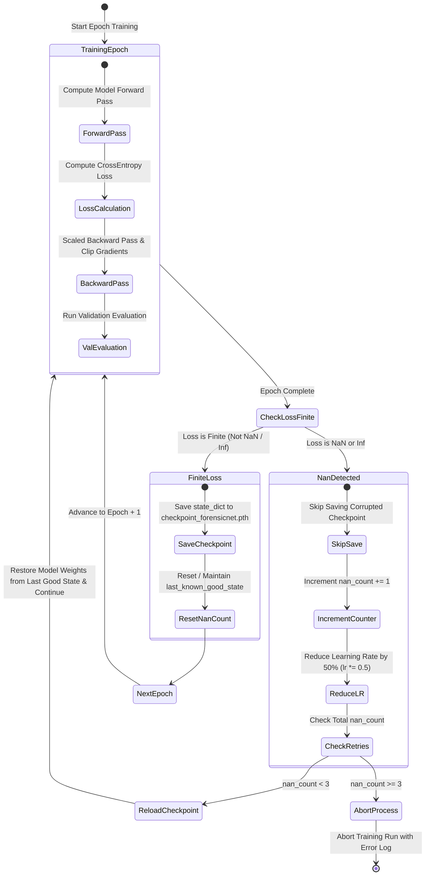

# 🐛 Known Issues & Resolved Technical Bugs

> [!INFO] Related Documents
> * Back to [[Index|Vault Home]]
> * [[Project Memory & Decision History]]
> * [[Model Version History]]
> * [[Development Rules]]
> * [[Security Guidelines]]

---

## 🛠️ Resolved Bugs & Technical Fixes

### 1. ForensicNet NaN Gradient Explosion Crash
* **Symptom:** During initial training of ForensicNet (`train_custom.py`), loss converged cleanly through Epoch 3 (val accuracy 91.42%), but abruptly exploded to `NaN` at Epoch 4, halting training.
* **Root Cause Analysis:** Multi-factor instability under Automatic Mixed Precision (`torch.cuda.amp.autocast` FP16):
  1. **FP16 FFT Normalization Underflow/Overflow:** In `compute_fft_spectrum()`, performing `(shifted_spectrum - amin) / (amax - amin + 1e-6)` in half precision (FP16) resulted in division by near-zero values when `amax - amin` fell below FP16 resolution limits, producing `inf` and `NaN` values.
  2. **In-Place Bayar Parameter Mutation:** `BayarConv2d.constrain_weights()` originally executed `self.conv.weight.data[:, :, 2, 2] = -1.0` directly modifying parameters in-place during the forward pass. This corrupted PyTorch autograd dependency graphs and invalidating `GradScaler` scale factors.
  3. **Unclipped Multi-Stream Gradients:** Gradient updates accumulated across three parallel streams (Bayar noise + FFT frequency + spatial RGB) without a max norm ceiling, triggering catastrophic gradient explosion.

#### NaN Detection & Auto-Rollback State Machine


* 🖼️ Static Image Fallback: [[../assets/diagrams/11-nan-detection-rollback-flow.png|Static PNG version (11-nan-detection-rollback-flow.png)]]

* **Fix Applied (`backend/ml/custom_model.py` & `backend/ml/train_custom.py`):**
  1. **FP32 Forced Execution Block:** Enclosed FFT magnitude computation in an explicit FP32 context:
     ```python
     with torch.autocast(device_type=device_type, enabled=False):
         x_f32 = x.float()
         fft_result = torch.fft.fft2(x_f32, dim=(-2, -1))
         # ... compute log magnitude ...
         normalized_spectrum = (shifted_spectrum - amin) / (amax - amin + 1e-6)
         normalized_spectrum = torch.clamp(normalized_spectrum, 0.0, 1.0)
     ```
  2. **Non-In-Place Weight Constraining:** Rewrote `BayarConv2d` weight filtering to use multiplicative zeroing masks non-in-place without mutating `self.conv.weight.data`.
  3. **Gradient Norm Clipping:** Injected `torch.nn.utils.clip_grad_norm_(model.parameters(), max_norm=1.0)` prior to optimizer step.
  4. **Learning Rate & Auto-Rollback Safeguard:** Lowered base learning rate to `5e-4` (CosineAnnealingLR) and added automated `NaN` detection that catches non-finite loss tensors and rolls back model state to the previous clean checkpoint.
* **Verification Method:** Executed a 3-epoch smoke test verifying stable, non-zero, non-NaN loss values before launching the successful full 40-epoch training run (**96.16% peak val accuracy**, **94.83% test accuracy**).

---

### 2. Parameter Count Hardcoding Bug & Discrepancy
* **Symptom:** Startup server logs reported `1.05M params` for ForensicNet, while static documentation or API helper functions returned mismatched parameters (e.g. `2.3M` or arbitrary hardcoded estimates).
* **Root Cause:** Parameter counts were hardcoded as static strings in multiple documentation files and API response helpers rather than derived dynamically from PyTorch model definitions.
* **Fix Applied (`backend/app/services/inference.py` & `backend/ml/compare_models.py`):**
  1. Implemented centralized parameter counter `get_model_param_count()` that dynamically iterates over `sum(p.numel() for p in model.parameters())` directly from PyTorch model instances.
  2. Integrated `format_params_count()` to format raw counts into clean strings (`4.66M` for EfficientNet-B0 [4,664,446], `1.05M` for ForensicNet [1,048,942]).
  3. Updated `GET /api/v1/models` and `compare_models.py` to consume live computed counts, creating a single source of truth across backend logs, REST APIs, and benchmark scripts.

---

### 3. DataLoader Subprocess Crash (`num_workers > 2`)
* **Symptom:** Running PyTorch DataLoader with high worker counts (`num_workers = 4` or `8`) caused shared memory allocation crashes or process deadlocks on Linux host systems.
* **Root Cause:** PyTorch worker process fork limitations and insufficient default POSIX shared memory (`/dev/shm`).
* **Resolution:** Added `benchmark_dataloader_workers()` function in `backend/ml/train.py` to dynamically test load speeds for `num_workers = [0, 2, 4, 6, 8]`. Recommended default pinned safely to `num_workers = 2`.

---

### 4. Truncated Image & Decompression Bomb Crashes
* **Symptom:** Large or corrupted uploaded images caused PIL to throw `DecompressionBombWarning` or crash on truncated bytes.
* **Root Cause:** Default Pillow safety limits triggering on large pixel dimensions.
* **Resolution:** Applied global guards in `dataset.py` and `inference.py`:
  ```python
  ImageFile.LOAD_TRUNCATED_IMAGES = False
  Image.MAX_IMAGE_PIXELS = None
  warnings.filterwarnings("ignore", category=Image.DecompressionBombWarning)
  ```

---

### 5. File Extension Spoofing Vulnerability
* **Symptom:** Attackers could rename text files or scripts to `.jpg` and bypass extension checks.
* **Root Cause:** Route handlers relied solely on `image.filename` or `image.content_type` headers.
* **Resolution:** Implemented `validate_image_magic_bytes()` in `security.py` to inspect initial file bytes (`FF D8 FF`, `\x89PNG`, `RIFF...WEBP`) before passing data to PIL or PyTorch.

---

### 6. SPA Path Traversal Security Leak
* **Symptom:** Potential path traversal vulnerabilities when serving static frontend files from FastAPI `/{file_name:path}`.
* **Root Cause:** Lack of absolute canonical path validation when joining request path parameters.
* **Resolution:** Added strict path checking in `main.py`:
  ```python
  if file_name.startswith("api/") or file_name == "health":
      raise HTTPException(status_code=404, detail="Not Found")
  file_path = os.path.abspath(os.path.join(frontend_dist_dir, file_name))
  if not file_path.startswith(frontend_dist_dir):
      raise HTTPException(status_code=403, detail="Access Denied")
  ```

---

## 🔍 Open Questions & Items Marked `[VERIFY]`

> [!WARNING] Open Engineering Items
> 1. **`forensics.db` Integration:** `backend/database.py` defines SQLite tables for tracking global visit counters (`total_visits`, `total_scanned`). `[VERIFY: Check whether global stats recording should be connected to active API routes.]`
> 2. **Scanner CSS Keyframe Animations:** `Scanner.tsx` references keyframe animation names for laser lines and cursor blinking that are omitted in `theme.css`. `[VERIFY: Check whether scanner keyframes should be added to theme.css.]`
