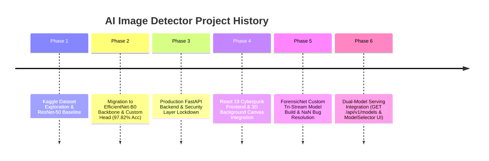

# 🧠 Project Memory & Technical Decision Log

> [!INFO] Related Documents
> * Back to [[Index|Vault Home]]
> * [[Known Issues & Resolved Bugs]]
> * [[Model Overview]]
> * [[Model Comparison]]
> * [[EfficientNet-B0]]
> * [[ForensicNet]]

---

## 📌 Architecture Decision Records (ADRs)

### ADR-001: Adoption of EfficientNet-B0 over ResNet-50
* **Date:** 2026-07-23
* **Status:** Accepted & Implemented
* **Context:** Early codebase exploration included ResNet-50 utilities (`backend/utils.py`). The team required an optimal balance between high classification accuracy and fast inference latencies on CPU and lower-end GPU instances.
* **Decision:** Selected `EfficientNet-B0` as the standard backbone for production serving (`backend/app/services/inference.py`).
* **Consequences:** Achieved **97.82% Accuracy** with **3.78 ms GPU / 12.24 ms CPU** inference latency, drastically outperforming ResNet-50 in parameter efficiency and speed.

---

### ADR-002: In-Memory Stream Processing (Zero Disk Retention)
* **Date:** 2026-07-23
* **Status:** Accepted & Implemented
* **Context:** Storing uploaded images to temporary files on disk introduces server I/O overhead, potential storage exhaustion vulnerabilities, and privacy concerns.
* **Decision:** Stream uploaded binary bytes directly into `io.BytesIO` buffers, decode using PIL in memory, and feed directly into PyTorch tensors.
* **Consequences:** Guarantees zero persistent storage of user images, enhances privacy compliance, and speeds up processing times.

---

### ADR-003: Layer Unfreezing at Epoch 8 (`--unfreeze_at 8`)
* **Date:** 2026-07-23
* **Status:** Accepted & Implemented
* **Context:** Training a deep convolutional neural network from scratch or unfreezing all layers immediately can lead to gradient instability and feature corruption in early epochs.
* **Decision:** Train only the newly appended classifier head for 7 epochs, then unfreeze all backbone parameters at Epoch 8 while reducing the learning rate by $10\times$.
* **Consequences:** Produced stable convergence, avoiding loss spikes and yielding **0.9979 AUC-ROC**.

---

### ADR-004: In-Memory Sliding Window Rate Limiter
* **Date:** 2026-07-23
* **Status:** Accepted & Implemented
* **Context:** Preventing API flooding without requiring heavy third-party infrastructure (like Redis) for small/local-first deployments.
* **Decision:** Implement `InMemoryRateLimiter` using Python `collections.deque` and sliding timestamps per IP address.
* **Consequences:** Lightweight, zero-dependency rate limiting protecting single (30 req/min) and batch (5 req/min) prediction endpoints.

---

### ADR-005: Custom Tri-Stream Architecture for ForensicNet
* **Date:** 2026-08-08
* **Status:** Accepted & Implemented
* **Context:** Standard pre-trained vision backbones (like EfficientNet) rely on high-level semantic features. Next-generation generative models produce photorealistic semantic content where spatial cues alone may fail. Forensic detection requires analyzing low-level pixel residual noise and frequency domain artifacts created by generator upsampling filters.
* **Decision:** Design and build a custom multi-stream neural network (`ForensicNet`) combining:
  1. **Bayar Constrained Convolution Stream:** Forces spatial prediction error extraction by constraining 5x5 filter center weights to -1 and non-center weights to sum to +1 ($\sum w = 0$).
  2. **2D FFT Frequency Domain Stream:** Computes 2D Discrete Fast Fourier log-magnitude spectrums to detect periodic grid anomalies.
  3. **Spatial RGB Stream:** Supplies spatial semantic context.
* **Consequences:** Built a compact model with **1,048,942 parameters** (4.4x smaller than EfficientNet-B0) capable of ultra-fast GPU forward passes (**1.78 ms**).

---

### ADR-006: Dual-Model Serving & Error Decorrelation Strategy
* **Date:** 2026-08-08
* **Status:** Accepted & Implemented
* **Context:** After evaluating ForensicNet (94.83% accuracy, 1.05M params, 1.78ms GPU) against EfficientNet-B0 (97.82% accuracy, 4.66M params, 3.78ms GPU), the team evaluated whether to replace EfficientNet or retain both.
* **Decision:** Keep BOTH models in active production serving rather than discarding one.
* **Reasoning:**
  - **Complementary Detection Paradigms:** EfficientNet-B0 inspects semantic feature representations, while ForensicNet inspects noise residuals and frequency domain artifacts. Their classification errors operate on orthogonal signal domains and are highly decorrelated.
  - **Deployment Flexibility:** ForensicNet offers a 4.4x smaller memory footprint and 2.1x faster GPU inference for edge/high-throughput API endpoints, while EfficientNet-B0 provides maximum accuracy and fast CPU inference.
* **Consequences:** Implemented dual-model lifespan loading in `inference.py`, added `GET /api/v1/models`, and added interactive model switching in `ModelSelector.tsx`.

---

## 📜 Historical Training & Milestone Timeline

